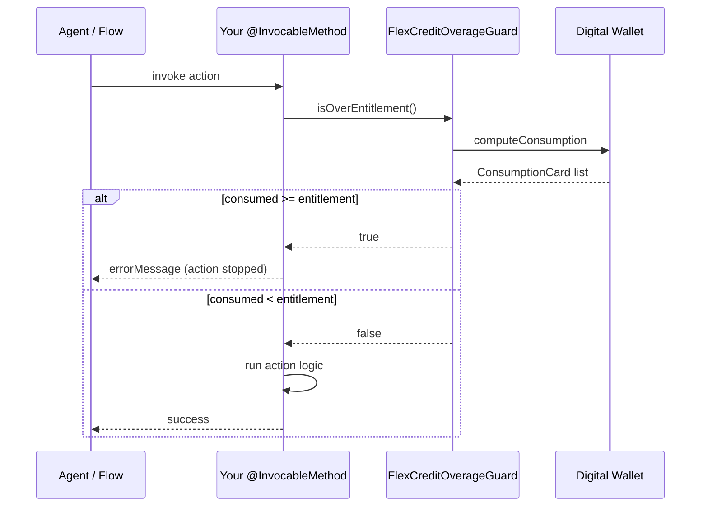

# apex-flex-credit-overage-guard

A guard that stops an Agentforce action or Flow before it runs when the org's
Flex Credits are already at their entitlement.

## Problem

Salesforce Digital Wallet does not throttle Agentforce at the entitlement boundary.
An action that runs at 100% usage pushes the org into overage. This guard checks
the Flex Credits balance at the start of a transaction and throws before any work
is done, keeping the org within its prepaid pool.

## Solution



`FlexCreditOverageGuard` is not itself an invocable action. It is a helper you call
from inside your `@InvocableMethod`. Your action class is what Agentforce Builder
and Flow Builder see.

## Usage

### Deploy

Requires an Enterprise or Unlimited org with Digital Wallet enabled (not available in sandboxes).

```bash
sf project deploy start --source-dir force-app
sf apex run test --tests FlexCreditOverageGuardTest --code-coverage --result-format human --wait 10
```

### Add the guard to your action

Call `isOverEntitlement()` at the top of your `@InvocableMethod`, before any DML,
and return an error message when it is `true`.

```apex
@InvocableMethod(label='My Action' description='Checks Flex Credits before running.')
public static List<Response> run(List<Request> requests) {
    Response result = new Response();
    if (FlexCreditOverageGuard.isOverEntitlement()) {
        result.errorMessage = 'Flex credit entitlement reached — action blocked.';
        return new List<Response>{ result };
    }
    // your action logic here
    return new List<Response>{ result };
}

public class Request  { /* your @InvocableVariable inputs */ }
public class Response {
    @InvocableVariable(label='Error Message') public String errorMessage;
}
```

### Wire the error message

Declare `errorMessage` as an `@InvocableVariable` on the response (shown above).
In Agentforce Builder or Flow Builder, map this output to a variable and instruct
the agent or flow to surface it when non-blank.

- **Agent Script** — [Actions](https://developer.salesforce.com/docs/ai/agentforce/guide/ascript-ref-actions.html) · [Variables](https://developer.salesforce.com/docs/ai/agentforce/guide/ascript-patterns-variables.html)
- **Flow Builder** — use a Decision element to branch on `errorMessage` and display it via a Screen element or fault path.

---

## Appendix

### How it works

`isOverEntitlement` calls the standard `computeConsumption` action once.
That action returns every `sfdw.ConsumptionCard`. The guard finds the card where
`cardDefinitionDeveloperName` is `FlexCredits`, `businessEnvType` is `Production`,
and `usageModel` is `PrePurchased`, then returns `true` when `unitsConsumed >= totalEntitlement`.

Card values are near-real-time, not a synchronous balance. There is no SOQL and
no package dependency beyond the `sfdw` namespace.

### Customizing the card filter

Change the three constants at the top of `FlexCreditOverageGuard.cls`.
The match is case-sensitive (`String.equals`, not Apex `==`).

| Constant | Default | Matches field |
| --- | --- | --- |
| `FLEX_CREDITS_CARD` | `FlexCredits` | `cardDefinitionDeveloperName` |
| `DEFAULT_BUSINESS_ENV` | `Production` | `businessEnvType` |
| `DEFAULT_USAGE_MODEL` | `PrePurchased` | `usageModel` |

### Return values

| Return | Meaning |
| --- | --- |
| `true` | Card found and `unitsConsumed >= totalEntitlement`. Block the action. |
| `false` | Card absent, action unavailable, `totalEntitlement` null, or `unitsConsumed < totalEntitlement`. Allow through — the platform enforces limits independently when no entitlement exists. |

A null `unitsConsumed` on a matched card is treated as `0`.

### Limitations

- Does not reserve credits — concurrent transactions can all pass the guard simultaneously.
- Does not estimate cost — a call that starts under the cap can finish over it.
- PayGo cards are designed to bill past a prepaid pool. This guard uses the PrePurchased card only.

### Out of scope

- **`@InvocableMethod`** — this class has no `@InvocableMethod` annotation and cannot appear directly in Flow Builder or Agentforce Builder. Wrap it in your own action class (see [Usage](#usage) above).
- **Fail-open mode** — when the action fails or the card is absent `isOverEntitlement()` returns `false` (allow through). There is no option to block on unavailability.
- **Async / scheduled monitoring** — no background job, no event-based alert as usage approaches the limit.
- **Multi-card aggregation or percentage thresholds** — one card, one binary check (`>= entitlement`).

### Org requirements

Enterprise or Unlimited org (or a Data One companion org) with Data 360 enabled.
`sourceApiVersion` 67.0; `sfdw` namespace and `computeConsumption` require 63.0 or later.
Digital Wallet is not available in sandboxes. The class will not compile in orgs
without the `sfdw` namespace.

To run the same check an action makes:

```bash
sf apex run --file scripts/apex/tryOverageGuard.apex
```

### Related

This project is a sibling of `apex-partner-digital-wallet`.
